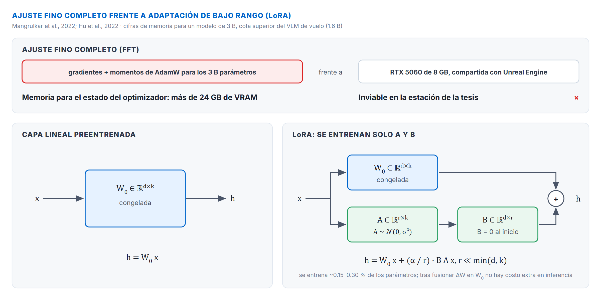
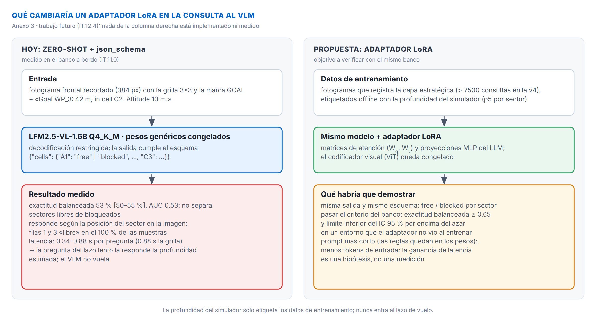

# Anexo 3: Optimización y especialización de modelos de visión-lenguaje mediante LoRA/QLoRA para navegación aérea autónoma

El modelo multimodal del sistema es **LFM2.5-VL-1.6B** (tag `lfm2.5-vl-1.6b:q4km-ctx8k`), ejecutado localmente bajo cuantización Q4_K_M en un entorno con recursos de cómputo y memoria de video acotados (IT.8.1); el otro candidato evaluado es **Qwen2.5-VL-3B-Instruct** (Qwen Team, 2025). Las cifras de memoria de este anexo se calcularon para el modelo de 3 B y son una cota superior para el de 1.6 B. Con la configuración por defecto el VLM no decide en vuelo, porque en el banco de prueba no distingue sectores libres de bloqueados (cap. 8; cap. 11, IT.11.0): una adaptación LoRA sería la vía para que lo haga, si el banco muestra que el modelo adaptado distingue sectores libres de bloqueados en un entorno que no vio durante el entrenamiento. Sin adaptar, el modelo opera en régimen *zero-shot / in-context learning*, guiado por prompts breves (IT.8.5) y acoplado a un motor de decodificación gramaticalmente restringida por esquema JSON (IT.8.2, Anexo 4; Willard & Louf, 2023).

Esta configuración tiene dos limitaciones operativas para el vuelo reactivo:

1. **Capacidad de discriminación:** el modelo generalista no separa sectores volables de bloqueados en la imagen de a bordo (AUC 0.53 en el banco) y responde con sesgos por posición en la grilla (Anexo 11, IT.A11.4.6).
2. **Latencia:** ~0.8 s por consulta con imagen en la GPU compartida con la simulación (cap. 8, IT.8.6), cuatro ciclos del lazo, frente a ~0.1 s de la red de profundidad.

Este anexo desarrolla los fundamentos matemáticos y metodológicos de **Adaptación de Bajo Rango (LoRA; [Hu et al., 2022](../13-REFERENCIAS.md#ref-hu-2022))** y sus extensiones contemporáneas (**QLoRA; Dettmers et al., 2024** y **DoRA; Liu et al., 2024**) como línea de trabajo futuro (IT.12.4): internalizar el dominio físico-espacial y el formato estricto directamente en los tensores de ponderación de la red, habilitando respuestas en tiempo real (< 500 ms) sin alterar la arquitectura base ni requerir hardware de nivel servidor.

---

## A3.1 Fundamentos matemáticos y variantes avanzadas de PEFT

El ajuste fino completo (*Full Fine-Tuning*, FFT) de una red neuronal profunda requiere actualizar y almacenar en memoria los gradientes y momentos del optimizador (e.g., AdamW en precisión simple FP32) para la totalidad de los parámetros entrenables $\Phi_0$. Para un modelo de 3B parámetros, esto demanda más de 24 GB de VRAM únicamente para el estado del optimizador, tornando inviable el entrenamiento en GPUs de escritorio (tales como la NVIDIA RTX 5060 de 8 GB utilizada en este proyecto).

Las técnicas de Ajuste Fino Eficiente en Parámetros (*Parameter-Efficient Fine-Tuning*, PEFT; [Mangrulkar et al., 2022](../13-REFERENCIAS.md#ref-mangrulkar-2022)) resuelven este cuello de botella congelando la red preentrenada y acoplando un conjunto microscópico de parámetros adaptativos.



### A3.1.1 Formulación matemática de LoRA
La premisa matemática de LoRA ([Hu et al., 2022](../13-REFERENCIAS.md#ref-hu-2022)) se basa en la hipótesis de que las actualizaciones de peso $\Delta W$ durante la adaptación a una tarea especializada exhiben un «rango intrínseco» muy bajo (*low intrinsic dimension*). Para una matriz lineal preentrenada $W_0 \in \mathbb{R}^{d \times k}$, la actualización se descompone como el producto de dos matrices de bajo rango:

$$W = W_0 + \Delta W = W_0 + \frac{\alpha}{r} (B \cdot A)$$

donde:

* $r \ll \min(d, k)$ es el hiperparámetro de **rango intrínseco** (típicamente $r \in [8, 32]$).
* $B \in \mathbb{R}^{d \times r}$ se inicializa estrictamente en ceros ($B = 0$).
* $A \in \mathbb{R}^{r \times k}$ se inicializa con una distribución normal gaussiana aleatoria $A \sim \mathcal{N}(0, \sigma^2)$, con $\sigma = \frac{1}{r}$.
* $\alpha \in \mathbb{R}^+$ es una constante de escala que atenúa o amplifica el impacto de la adaptación sin requerir reajustar la tasa de aprendizaje (*learning rate*) al modificar $r$.

**Propiedad de preservación funcional:** gracias a la inicialización $B = 0$, en el paso inicial de entrenamiento se cumple que $\Delta W = 0 \cdot A = 0$. Por lo tanto, $W = W_0$ y el comportamiento inicial del modelo es matemáticamente idéntico al modelo preentrenado de fábrica, evitando saltos destructivos en los pesos durante las primeras iteraciones.

### A3.1.2 Selección de módulos objetivo en arquitecturas multimodales
En modelos basados en Transformer, las proyecciones lineales se dividen entre el bloque de autoatención (*Multi-Head Attention*) y el perceptrón multicapa (*Feed-Forward Network* / MLP):

* **Atención:** matrices de consulta ($W_q$), clave ($W_k$), valor ($W_v$) y proyección de salida ($W_o$).
* **MLP:** matrices de compuerta ($W_{\text{gate}}$), subida ($W_{\text{up}}$) y bajada ($W_{\text{down}}$).

Para modelos multimodales (sVLMs como Qwen2.5-VL), existe una disyuntiva de diseño crítica:

1. **Codificador visual (*Vision Transformer*, ViT):** procesa los parches de píxeles brutos de la cámara monocular. Adaptar el ViT con LoRA introduce el riesgo de destruir filtros de detección de bordes y texturas universales ante conjuntos de datos de vuelo acotados. Por ello, la práctica recomendada consiste en **mantener el ViT congelado**.
2. **Proyector multimodal y capas del LLM autorregresivo:** adaptar $W_q, W_v$ y las capas lineales del MLP permite al modelo remapear las representaciones visuales hacia la lógica de control del dron. La literatura empírica demuestra que incorporar tanto los módulos de atención como los del bloque MLP ($W_{\text{gate}}, W_{\text{up}}, W_{\text{down}}$) con rangos moderados ($r=16$) supera consistentemente a adaptar únicamente $W_q$ con rangos mayores ($r=64$).

### A3.1.3 QLoRA: cuantización en 4 bits y optimizadores paginados
Para posibilitar la sintonización en hardware de desarrollo restringido, [Dettmers et al. (2024)](../13-REFERENCIAS.md#ref-dettmers-2024) introdujeron **QLoRA**, una extensión que combina tres innovaciones clave:

* **Formato NormalFloat4 (NF4):** un tipo de datos no lineal de 4 bits con espaciado óptimo para representar tensores con distribución normal estándar centrada en cero, conservando un error de cuantización teóricamente menor que el formato entero uniforme INT4.
* **Doble Cuantización (*Double Quantization*):** proceso que cuantiza las propias constantes de escala de cuantización del modelo (de FP32 a FP8 en bloques de 256 elementos), ahorrando un promedio de 0.37 bits por parámetro (~370 MB en un modelo de 3B).
* **Optimizadores Paginados (*Paged Optimizers*):** integración con CUDA Memory Management para trasladar dinámicamente los estados de memoria de la GPU a la memoria RAM del sistema operativo durante picos transitorios de gradientes, previniendo fallos por memoria agotada (*Out-Of-Memory*, OOM).

En este esquema, el modelo base $W_0$ reside en VRAM cuantizado en 4 bits NF4 ($~1.8\text{ GB}$ para 3B), mientras que los adaptadores $A$ y $B$ se mantienen y optimizan en precisión bfloat16 ($~25\text{ MB}$).

### A3.1.4 DoRA: adaptación desacoplada en magnitud y dirección
[Liu et al. (2024)](../13-REFERENCIAS.md#ref-liu-dora-2024) observaron una discrepancia estructural en la dinámica de gradientes: mientras que el ajuste completo (FFT) modifica tanto la magnitud como la dirección de los vectores de pesos de forma desbalanceada e independiente, LoRA exhibe un acoplamiento simétrico entre ambas dimensiones.

Para solventar esta limitación, **DoRA (*Weight-Decomposed Low-Rank Adaptation*)** factoriza cada columna de la matriz de ponderación $W \in \mathbb{R}^{d \times k}$ en su vector de magnitud de norma euclidiana $m \in \mathbb{R}^{1 \times k}$ y su matriz direccional unitaria normalizada $V \in \mathbb{R}^{d \times k}$:

$$W = m \odot \frac{V}{\|V\|_c} = m \odot \frac{W_0 + \Delta W}{\|W_0 + \Delta W\|_c}$$

donde $\| \cdot \|_c$ denota la norma $L_2$ a lo largo de las columnas y $\Delta W = \frac{\alpha}{r} B A$. DoRA permite que el gradiente ajuste la escala global de activación ($m$) independientemente de las reorientaciones vectoriales ($\Delta W$), logrando una capacidad de modelado que equipara prácticamente a FFT en tareas espaciales y de razonamiento lógico, manteniendo la ventaja de poder fusionarse íntegramente en inferencia sin penalización de velocidad.

### A3.1.5 Comparativa de paradigmas de ajuste fino para sVLMs

| Dimensión | Full Fine-Tuning (FFT) | LoRA estándar | QLoRA (NF4) | DoRA |
|---|---|---|---|---|
| **VRAM entrenamiento (3B)** | > 24 GB | ~12–14 GB | **~5.5–7.0 GB** | ~6.5–8.0 GB |
| **Parámetros entrenables** | 100% (~3.090 M) | ~0.15–0.30% (~5–10 M) | ~0.15–0.30% (~5–10 M) | ~0.20–0.35% (~6–11 M) |
| **Precisión pesos base** | FP16 / BF16 | FP16 / BF16 | **NF4 (4 bits)** | NF4 / FP16 |
| **Sobrecarga en inferencia** | Cero (pesos nativos) | Cero (tras fusión) | Cero (tras fusión + quant) | Cero (tras fusión) |
| **Fidelidad respecto a FFT** | Referencia (100%) | 92–95% | 91–94% | **97–99%** |
| **Viabilidad en GPU 8 GB** | No viable | Crítico / Marginal | **Plenamente viable** | **Plenamente viable** |

---

## A3.2 Justificación técnica: impacto de LoRA en el lazo táctico de DroneLM

La integración de un adaptador LoRA en la consulta al VLM transforma la interfaz entre el modelo de lenguaje y el sistema ciberfísico:



### A3.2.1 Reducción del presupuesto de tokens y compresión de latencia
En el régimen *zero-shot* actual (IT.8.5), cada consulta de la capa estratégica reitera en el *system prompt*:

* La definición de la grilla de 3×3 (columnas A–C, filas 1–3) y de la marca de la meta.
* El criterio operativo: `free` si el dron puede volar 15 m en esa dirección, `blocked` si hay un edificio, muro, árbol, puente o techo más cerca.
* La instrucción de responder solo con JSON (la forma la fija el esquema de IT.8.2.1).

Al especializar el modelo con LoRA, **el criterio y la forma de la respuesta quedan incorporados en los pesos**, y la consulta puede reducirse al *user prompt* que ya usa el sistema más la imagen con la grilla dibujada:

```
Goal WP_3: 34 m, in cell B2. Altitude 10 m.   + [Front camera, 3x3 grid]
```

El ahorro es acotado: el *system prompt* ya tiene tres o cuatro oraciones, y la mayor parte del preprocesamiento (*prefill*) la ocupan los 64–256 tokens con que el codificador visual representa la imagen (IT.8.1.2), que LoRA no reduce. La ganancia esperable de LoRA no es de latencia —la consulta ya tarda ~0.8 s, muy por debajo de la edad máxima de 10 s de una respuesta (IT.8.6)— sino de discriminación (IT.A3.2.2).

### A3.2.2 Discriminación de sectores: de la posición en la imagen a la escena
El banco de prueba muestra que el modelo sin adaptar responde sobre todo a la posición del sector y no a la escena: las filas superior e inferior de la grilla salen «libres» en todas las muestras, la fila del medio depende de la columna, y los *logprobs* no rescatan la grilla (exactitud balanceada 0.53, AUC 0.53; cap. 11, IT.11.0). LoRA permite reentrenar la distribución condicional $P(y \mid X)$ sobre pares con etiqueta de referencia para que la respuesta dependa de lo que hay en cada sector:

* Juzgar la distancia a lo que ocupa cada sector frente al criterio de 15 m, en lugar de reproducir un patrón fijo por fila.
* Discriminar si una región oscura corresponde a una sombra sobre el pavimento (transitable) o a un obstáculo sólido en el volumen de vuelo (no transitable), el tipo de ambigüedad que el flujo monocular tampoco resuelve (IT.6.1).

La adaptación solo se justificaría si el banco de prueba, sobre un entorno no visto en el entrenamiento, supera el criterio de pase de IT.11.0 (exactitud balanceada ≥ 0.65 con el límite inferior del IC 95 % por encima del azar).

---

## A3.3 Pipeline de ingeniería de datos para navegación aérea

El factor determinante del éxito de la adaptación no radica en el volumen de parámetros, sino en la calidad informativa y la diversidad topológica del conjunto de datos de entrenamiento.

### A3.3.1 Estructura del dataset multimodal de navegación
Cada instancia de entrenamiento es un par supervisado $(X_t, Y_t)$ con la misma forma que la consulta estratégica del sistema (IT.8.2.1, IT.A4.9.2):

$$X_t = \left\{ I_t^{\text{grilla}},\ \text{prompt}_t \right\}$$

$$Y_t = \left\{ \text{"cells"}: \{A1, \dots, C3\} \to \{\text{free}, \text{blocked}\} \right\}$$

donde:

* $I_t^{\text{grilla}}$ es el fotograma de la cámara frontal reducido a 384 px, con la grilla de 3×3 y la marca de la meta dibujadas, tal como lo recibe el modelo en vuelo.
* $\text{prompt}_t$ es el *user prompt* con la distancia a la meta, su sector (o su ángulo si está fuera del recorte) y la altitud.
* $Y_t$ asigna a cada uno de los nueve sectores la etiqueta de referencia: `free` si el percentil 5 de la profundidad planar del simulador en el sector es ≥ 15 m y `blocked` si no (cap. 7, IT.7.1). La profundidad del simulador solo etiqueta los datos; el modelo nunca la recibe.

El mismo esquema vale para el barrido, con cuatro imágenes numeradas y la salida `views` del esquema panorámico (IT.8.2.1).

### A3.3.2 Mitigación de la deriva cinemática mediante DAgger
El entrenamiento mediante simple Clonación de Comportamiento (*Behavioral Cloning*, BC) a partir de vuelos nominales perfectos sufre del problema de **deriva covariada (*Covariate Shift*)** ([Codevilla et al., 2019](../13-REFERENCIAS.md#ref-codevilla-2019)): ante el menor error acumulado de predicción, el vehículo ingresa en estados cinemáticos no presentes en el conjunto de entrenamiento, colapsando en decisiones divergentes.

Para inmunizar al modelo frente a este fenómeno, se define la aplicación del algoritmo **DAgger (*Dataset Aggregation*; [Ross et al., 2011](../13-REFERENCIAS.md#ref-ross-2011))** adaptado a simulación en AirSim / Unreal Engine 5:

1. **Vuelo con política actual** $\pi_{\text{LoRA}}$ en AirSim UE5.5 bajo perturbaciones controladas (ráfagas de viento sintéticas, desviaciones forzadas).
2. **Etiquetado por el oráculo** en los estados que visita la política adaptada: la profundidad planar del simulador produce la etiqueta de referencia $Y^*$ de cada sector, también en las situaciones a las que el dron llega por sus propios errores.
3. **Agregación de tuplas críticas** $\mathcal{D}_{\text{total}} = \mathcal{D}_{\text{previo}} \cup \{(X_{\text{perturbado}}, Y^*_{\text{oráculo}})\}$.
4. **Reentrenamiento iterativo** de los adaptadores LoRA sobre el conjunto enriquecido.

### A3.3.3 Aumentación sintética y métricas objetivo de evaluación
Para evitar el sobreajuste a texturas específicas de los mapas virtuales de Unreal Engine (TownSim, CitySim; cap. 3 y 10), el conjunto de datos se somete a aumentaciones dinámicas: variación de la hora solar en UE5, degradación atmosférica sintética (niebla y dispersión lumínica; [Marazzato & Sparavigna, 2015](../13-REFERENCIAS.md#ref-marazzato-2015)) y desenfoque por movimiento angular (*motion blur*).

| Métrica de validación | *Zero-shot* actual (LFM2.5-VL-1.6B) | Objetivo con LoRA / QLoRA |
|---|---|---|
| **Exactitud balanceada de la grilla** (banco, IT.11.0) | 0.53 | **≥ 0.65**, IC 95 % sobre el azar, en un entorno no visto |
| **AUC de la grilla con *logprobs*** (diagnóstico) | 0.53 | > 0.75 |
| **Barrido: rumbo transitable** (banco, IT.11.0) | no pasa el criterio | pasa el criterio |
| **Adherencia al esquema JSON** (IT.8.2.1) | ~98 % con decodificación restringida | ~100 % |
| **Latencia de la consulta estratégica** (IT.8.6) | ~0.8 s | sin cambio (< 10 s de edad máxima) |

Las cifras objetivo son criterios de pase, no resultados: ninguna adaptación se entrenó en esta tesis (IT.8.7).

---

## A3.4 Fusión de pesos, despliegue y preservación de la seguridad híbrida

### A3.4.1 Fusión algebraica de pesos (*Weight Merging*) y exportación
Una de las ventajas arquitectónicas centrales de LoRA frente a otros esquemas modulares radica en la posibilidad de **fusionar algebraicamente los adaptadores con los pesos base preentrenados** antes del despliegue en el vehículo:

$$W_{\text{despliegue}} = W_0 + \frac{\alpha}{r} (B \cdot A)$$

Al realizar la fusión de tensores en punto flotante previo (FP16 o BF16), la matriz resultante $W_{\text{despliegue}}$ adquiere exactamente las mismas dimensiones y topología que la red preentrenada original. No existe ninguna bifurcación de memoria ni sobrecarga computacional adicional durante la inferencia. 

Posteriormente, el modelo fusionado se compila a formato **GGUF** cuantizado (`Q4_K_M`) mediante `llama.cpp` ([Gerganov, 2023](../13-REFERENCIAS.md#ref-gerganov-2023)), el mismo formato y la misma cuantización que el modelo adoptado (731 MB más el codificador visual para LFM2.5-VL-1.6B, IT.8.1.2), listo para ejecución local sin dependencias de librerías de entrenamiento y servido por Ollama igual que hoy.

### A3.4.2 Sinergia entre LoRA y decodificación restringida (`json_schema`)
El ajuste fino no reemplaza la decodificación restringida por gramáticas (IT.8.2, Anexo 4), sino que la complementa:

* **LoRA moldea la distribución interna de logits:** el modelo aprende a concentrar prácticamente toda su masa de probabilidad en las claves del esquema JSON y en los valores de sus enums (`free`/`blocked`; los seis valores de `view`).
* **`json_schema` opera como barrera determinista externa:** enmascara el residuo infinitesimal de probabilidad en situaciones fuera de distribución, garantizando formalmente cero violaciones de formato.
* **Aceleración de generación:** al fluir la decodificación sin colisionar con tokens suprimidos por la gramática, la tasa de muestreo alcanza el máximo rendimiento teórico del motor de inferencia.

### A3.4.3 Salvaguardas inalteradas y hoja de ruta de transferencia
Un principio fundacional de DroneLM es que los modelos de lenguaje son aproximadores estocásticos y **bajo ninguna circunstancia deben gobernar de forma directa los actuadores físicos sin arbitraje determinista** (Gat, 1998; cap. 5 y 8). La incorporación de adaptadores LoRA preserva íntegramente las tres salvaguardas del sistema:

1. **Lazo rápido único que comanda velocidades:** la capa deliberativa solo propone sub-metas ancladas al mundo; la evasión por flujo óptico y TTC sigue actuando en el mismo ciclo ante cualquier riesgo inminente (cap. 5, IT.5.3.3).
2. **Parser por modo:** valida cada respuesta contra su esquema y rechaza la que no coincide, sin sustituirla por un valor por defecto (IT.8.2.2).
3. **Perro guardián temporal** (`SLM_DEEP_WATCHDOG_MS`, 18 s en el barrido; edad máxima de 10 s en la capa estratégica, cap. 8, IT.8.6): una respuesta tardía se descarta y el barrido cae al escape vertical.

Como línea de extensión formulada en el trabajo futuro (IT.12.4), esta especialización posibilitará la transferencia de la capa deliberativa a plataformas de cómputo en borde (NVIDIA Jetson Orin Nano / Xavier NX con enlaces serie MAVLink hacia autopilotos PX4), consolidando a DroneLM como un copiloto táctico local, seguro por diseño y plenamente autónomo en entornos reales.
