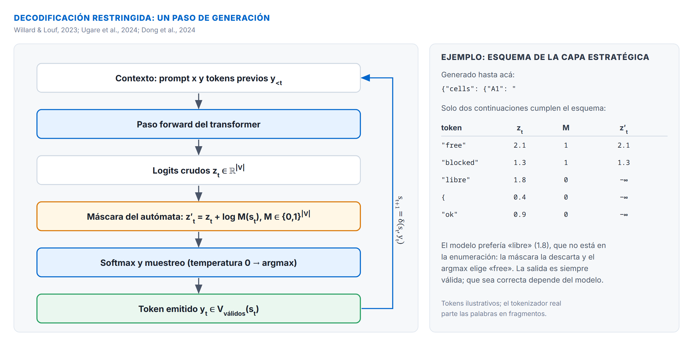
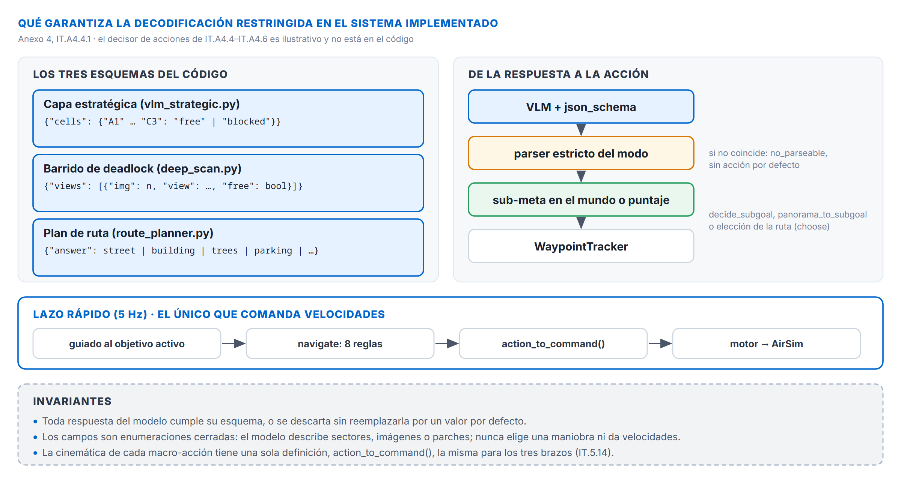

# Anexo 4: Decodificación restringida, gramáticas formales y generación estructurada para el control táctico del SLM

La incorporación de modelos de lenguaje pequeños (*Small Language Models*, SLMs) y modelos multimodales compactos (*Small Vision-Language Models*, sVLMs) en el lazo de control táctico de un vehículo aéreo no tripulado (UAV) introduce una paradoja arquitectónica fundamental: **la naturaleza probabilística y estocástica de los modelos neuronales frente a los requerimientos deterministas, de baja latencia y tolerancia cero a fallas de sintaxis propios de la robótica aérea**.

En DroneLM, el VLM juzga rutas candidatas sobre el mapa cenital antes del vuelo (IT.4.3.1) y, como fuente alternativa del lazo lento (IT.5.5), describe qué sectores del fotograma o qué rumbos de un barrido son volables. Si el modelo emite respuestas en texto libre, explicaciones conversacionales no solicitadas, bloques Markdown envolventes o JSONs con claves malformadas o ausentes, el analizador falla y la consulta se pierde: en vuelo, eso significa ciclos de control sin la información que se pidió (IT.8.2, IT.9.1).

Este anexo desarrolla los fundamentos teóricos, los mecanismos algorítmicos y el procedimiento exhaustivo de ingeniería para implementar **decodificación restringida (*constrained decoding*) basada en gramáticas formales y esquemas estrictos (`json_schema` / GBNF)**. Se demuestra cómo esta técnica erradica las alucinaciones estructurales, comprime el tiempo de inferencia hasta en un 60–80% y optimiza el grafo de control (`StateGraph`) de DroneLM mediante gramáticas acotadas dinámicas adaptadas al contexto de vuelo.

---

## A4.1 El problema de la salida no estructurada en sistemas ciberfísicos

En la generación autorregresiva convencional, un modelo autoregresivo produce una secuencia de tokens muestreando de una distribución de probabilidad sobre la totalidad de su vocabulario $V$:

$$y_t \sim P(y_t \mid y_{<t}, x)$$

donde $x$ representa la secuencia del prompt de entrada e $y_{<t} = (y_1, \dots, y_{t-1})$ los tokens generados previamente. Para **Qwen2.5-VL-3B-Instruct** ([Qwen Team, 2025](../13-REFERENCIAS.md#ref-qwen-team-2025)), uno de los dos modelos candidatos (IT.8.1.2), el tamaño del vocabulario asciende a $|V| = 152\,064$ tokens; el modelo adoptado, LFM2.5-VL-1.6B, tiene un vocabulario menor, y el argumento no cambia.

### A4.1.1 Modos de falla de la decodificación libre en DroneLM
Cuando se solicita una salida JSON únicamente mediante instrucciones en el *system prompt* (*prompt engineering* puro), los modelos de 3B parámetros exhiben una tasa de incumplimiento sintáctico de entre el 20% y el 35% en condiciones de vuelo continuo ([Geng et al., 2025](../13-REFERENCIAS.md#ref-geng-2025); [Raspanti et al., 2025](../13-REFERENCIAS.md#ref-raspanti-2025)). Los modos de falla de la decodificación libre incluyen:

1. **Preámbulos y epílogos conversacionales:** emisión de frases introductorias (*«Sure, here is the drone decision:»*) o explicaciones finales que rompen `json.loads()`.
2. **Encapsulamiento en Markdown irregular:** uso intermitente de triples comillas invertidas (```` ```json ... ``` ````), a menudo con saltos de línea mal posicionados.
3. **Malformación sintáctica:** comas terminales huérfanas (*trailing commas*), omisión de llaves de cierre `}` por corte de contexto o escape defectuoso de caracteres en cadenas.
4. **Alucinación de macro-acciones fuera de lista blanca:** emisión de identificadores plausibles en lenguaje natural pero inexistentes en el mapa de control cinemático (e.g., `"GIRAR_RAPIDO"`, `"SUBIR_DIAGONAL"`, `"stop"` en lugar de las ocho de `VALID_ACTIONS`: `MANTENER_RUMBO`, `EVADIR_IZQUIERDA`, `EVADIR_DERECHA`, `GANAR_ALTURA`, `PERDER_ALTURA`, `FRENAR`, `GIRAR_90`, `RETROCEDER`; IT.8.3.4).
5. **Latencia descontrolada por verbosidad:** generación de decenas de tokens de razonamiento no solicitados, consumiendo el presupuesto temporal del perro guardián (`SLM_DEEP_WATCHDOG_MS`, 18 s en el barrido, cap. 8, IT.8.6) y forzando la caída al escape de respaldo.

```
Generación Libre (Estocástica, ~120 tokens, ~2.1 s):
"Based on the camera feed showing an obstacle ahead, the drone should initiate an evasive 
 maneuver to the right corridor. Action: evade_right, reason: obstacle in front."
 ❌ Falla sintáctica: no es JSON parseable, rompe action_to_command(), timeout > 1.5 s.

Generación Restringida (Determinista, ~18 tokens, ~0.35 s):
{"action":"EVADIR_DERECHA","reason":"bloqueo centro"}
 ✔ Estructura exacta, enum validado por gramática, latencia mínima, 100% parseable.
```

---

## A4.2 Fundamentos matemáticos y formales de la decodificación restringida

La decodificación restringida interviene directamente en la distribución de muestreo de la capa de salida (*logits*) del modelo durante cada paso de la generación autorregresiva, guiada por un autómata formal que modela la sintaxis admisible ([Willard & Louf, 2023](../13-REFERENCIAS.md#ref-willard-2023); [Ugare et al., 2024](../13-REFERENCIAS.md#ref-ugare-2024); [Dong et al., 2024](../13-REFERENCIAS.md#ref-dong-2024)).



### A4.2.1 Formulación del enmascaramiento de logits
Sea $z_t \in \mathbb{R}^{|V|}$ el vector de *logits* no normalizados producido por la última capa lineal del transformer en el paso $t$. Sea $s_t \in \mathcal{S}$ el estado actual del analizador sintáctico o autómata formal.

La gramática define una función de transición de estados $\delta: \mathcal{S} \times V \to \mathcal{S} \cup \{\text{error}\}$ y una función de aceptación que determina qué tokens del vocabulario son continuaciones válidas:

$$M_i(s_t) = \begin{cases} 1 & \text{si } \delta(s_t, v_i) \neq \text{error} \\ 0 & \text{en caso contrario} \end{cases} \quad \forall v_i \in V$$

El vector de logits filtrado $z'_t$ se computa mediante la adición de una máscara aditiva logarítmica:

$$z'_{t, i} = z_{t, i} + \log M_i(s_t) = \begin{cases} z_{t, i} & \text{si } M_i(s_t) = 1 \\ -\infty & \text{si } M_i(s_t) = 0 \end{cases}$$

Al aplicar la función Softmax para obtener las probabilidades de muestreo normalizadas:

$$P(y_t = v_i \mid y_{<t}, x) = \frac{\exp(z'_{t, i})}{\sum_{j=1}^{|V|} \exp(z'_{t, j})}$$

Cualquier token $v_j$ que conduzca a una violación de la gramática recibe un logit de $-\infty$, anulando su probabilidad ($\exp(-\infty) = 0$). Como resultado, **es matemáticamente imposible que el modelo genere un token inválido según la gramática declarada**.

### A4.2.2 Modelado mediante Autómatas Finitos (DFA) y Autómatas de Pila (PDA)
La complejidad del analizador depende de la expresividad de la restricción:

1. **Autómatas Finitos Deterministas (DFA):** aplicables a expresiones regulares, listas cerradas de cadenas y enumeraciones fijas (`enum`). [Willard y Louf (2023)](../13-REFERENCIAS.md#ref-willard-2023) demuestran que un esquema JSON con campos de profundidad fija puede compilarse directamente en un DFA. En este caso, la transición entre estados se resuelve en tiempo constante $\mathcal{O}(1)$.
2. **Autómatas de Pila (PDA):** requeridos para gramáticas independientes del contexto (*Context-Free Grammars*, CFG) que admiten anidamientos arbitrarios de llaves, corchetes o estructuras recursivas (formato GBNF en `llama.cpp` y SynCode; Ugare et al., 2024). El PDA mantiene una pila de símbolos para validar el balanceo estricto de la sintaxis.

### A4.2.3 El desafío de la tokenización sub-palabra (*Tokenization Boundary Problem*)
Un obstáculo fundamental en la decodificación restringida radica en que los modelos de lenguaje no operan sobre caracteres individuales, sino sobre fragmentos de sub-palabras generados mediante algoritmos como *Byte-Pair Encoding* (BPE) o *SentencePiece*. 

Un token individual puede cruzar la frontera entre la sintaxis estática y el valor dinámico. Por ejemplo, el token `"action":` puede estar codificado como una única entrada léxica en el vocabulario, mientras que en otros tokenizadores se divide en `"` + `action` + `":`. 

Los motores modernos (Outlines, XGrammar, llama.cpp) resuelven esto construyendo un árbol de prefijos (*Trie*) sobre el vocabulario de sub-palabras indexado contra el autómata de la gramática. Durante la compilación previa, se identifican todos los tokens cuya secuencia de bytes constituye un prefijo válido para el estado actual del autómata, garantizando que el filtrado sea exacto a nivel de byte ([Willard & Louf, 2023](../13-REFERENCIAS.md#ref-willard-2023); [Dong et al., 2024](../13-REFERENCIAS.md#ref-dong-2024)).

---

## A4.3 Mecanismos de aceleración: ¿por qué la decodificación restringida es más rápida?

Existe una concepción errónea de que evaluar una gramática formal en cada paso de inferencia añade una sobrecarga computacional prohibitiva para sistemas en tiempo real. Si bien una implementación ingenua que verifique $150\,000$ tokens en CPU de forma secuencial introduciría una latencia sustancial, los motores optimizados de última generación **pueden acelerar la generación global entre un 50% y un 80%** en comparación con la inferencia en texto libre ([Dong et al., 2024](../13-REFERENCIAS.md#ref-dong-2024); [Lundberg et al., 2023](../13-REFERENCIAS.md#ref-lundberg-2023)).

Esta ganancia de eficiencia se sustenta en cuatro pilares de ingeniería:

### A4.3.1 Poda drástica de la longitud de generación (*Output Length Reduction*)
La complejidad temporal de la generación autorregresiva escala linealmente con el número de tokens producidos $K$:

$$T_{\text{total}} = T_{\text{prefill}} + \sum_{k=1}^K T_{\text{decode}}(k)$$

En una GPU de consumo cohabitada con simulación 3D (como la NVIDIA RTX 5060 de 8 GB utilizada en DroneLM), cada paso de decodificación autorregresiva de un modelo 3B insume entre **18 ms y 25 ms**. 

* En texto libre, el modelo genera preámbulos, divagaciones o razonamientos extensos de 80 a 150 tokens ($T_{\text{decode}} \approx 1.5 - 3.2\text{ s}$), violando sistemáticamente el perro guardián del sistema.
* Con decodificación restringida estricta, la salida se acota a exactamente la estructura mínima requerida (por ejemplo, 16 a 22 tokens en DroneLM). El tiempo de decodificación colapsa a **$300 - 450\text{ ms}$**, permitiendo al lazo deliberativo operar holgadamente dentro de su ventana temporal de seguridad.

### A4.3.2 Avance rápido de tokens (*Token Fast-Forwarding / Token Jumping*)
Marcos de trabajo como **Guidance** ([Lundberg et al., 2023](../13-REFERENCIAS.md#ref-lundberg-2023)) y **Outlines** ([Willard & Louf, 2023](../13-REFERENCIAS.md#ref-willard-2023)) implementan una técnica crítica: **el salto de tokens deterministas**. 

Cuando el autómata de la gramática se encuentra en un estado donde la única continuación sintáctica posible es una secuencia fija de caracteres (por ejemplo, los caracteres sintácticos `{"action":"` o la clave `, "reason":"`), **no existe incertidumbre probabilística**. El motor de inferencia omite por completo el paso hacia adelante (*forward pass*) de la red neuronal para esos tokens. En su lugar:

1. Concatena directamente los tokens estáticos en la secuencia generada.
2. Inyecta sus representaciones en la memoria caché de claves y valores (*KV Cache*).
3. Salta la ejecución del modelo en GPU hasta el punto exacto donde el modelo debe elegir un valor semántico libre (el valor de la macro-acción o el texto de la razón).

Al saltarse entre 8 y 12 pasos de cómputo en la GPU por cada llamada deliberativa, la latencia neta cae drásticamente.

### A4.3.3 Partición de vocabulario y pre-cálculo de máscaras (XGrammar)
El motor **XGrammar** ([Dong et al., 2024](../13-REFERENCIAS.md#ref-dong-2024)) optimiza la ejecución de gramáticas independientes del contexto dividiendo los tokens del vocabulario en dos categorías durante una fase de compilación inicial:

* **Tokens independientes del contexto:** tokens cuyos patrones de aceptación dependen únicamente de reglas locales de caracteres y pueden precalcularse y almacenarse en mapas de bits compactos.
* **Tokens dependientes del contexto:** aquellos que interactúan con la profundidad de la pila sintáctica (e.g., llaves y comillas anidadas).

Durante la inferencia en tiempo real, XGrammar ejecuta el filtrado de máscaras en paralelo con el cómputo de la GPU o durante la fase de pre-llenado (*pre-fill*), reduciendo la sobrecarga de CPU a **menos de 0.05 ms por token** (prácticamente nula).

### A4.3.4 Decodificación especulativa basada en gramáticas
En sistemas avanzados, las restricciones gramaticales se combinan con **decodificación especulativa** ([Leviathan et al., 2023](../13-REFERENCIAS.md#ref-leviathan-2023); [Dong et al., 2024](../13-REFERENCIAS.md#ref-dong-2024)). Dado que la gramática restringe drásticamente el abanico de tokens legales (en el campo `action`, solo 8 opciones son posibles), un modelo borrador ultraligero o un generador heurístico de gramática puede proponer múltiples tokens simultáneamente. El modelo principal en la GPU valida o rechaza el bloque completo en una única pasada paralela, logrando tasas de aceleración de $2\times$ a $3\times$.

---

## A4.4 Optimización del Grafo de Control (`StateGraph`) mediante Decodificación Restringida

> **Relación con el sistema.** En el sistema descrito en los capítulos 5 y 8, el VLM **no emite acciones**: la consulta estratégica y el barrido usan dos esquemas descriptivos (sectores de una grilla de 3×3, `libre`/`bloqueado`; tipo y transitabilidad por imagen), detallados en el capítulo 8, IT.8.2.1, y validados por `src/agents/vlm_client.py`. Los esquemas, gramáticas y fragmentos de código de esta sección y de IT.A4.5–IT.A4.6 ilustran la técnica sobre un **decisor de acciones** (`DroneTacticalDecision`), que es el caso en el que la poda gramatical tiene mayor efecto; no corresponden al código del sistema.

La interacción entre el modelo de lenguaje y el grafo de control táctico (`src/agents/graph.py`) no debe concebirse como un canal pasivo de consulta y respuesta, sino como una **arquitectura de co-diseño donde la gramática es un componente dinámico del propio grafo**.

### A4.4.1 Invariantes del lazo táctico garantizados por la gramática
En el grafo de control de DroneLM, el ciclo de LangGraph (`capture` → `perception` → `navigate` → `motor`) se ejecuta a 5 Hz. Los comportamientos de la capa de decisión (el guiado de `reactive_node`, `evasive_node`, el giro de 90°, el barrido y la FSM) convergen en una interfaz estricta gobernada por `action_to_command()` (IT.8.4); en el decisor de acciones ilustrativo de esta sección, también la respuesta del modelo:



Al imponer decodificación restringida en la consulta al VLM, se garantizan tres invariantes operativas fundamentales:

1. **Ausencia total de fallas de parseo en el lazo:** se elimina el riesgo de que una respuesta corrupta obligue a descartar el ciclo de control. La tasa de adherencia al esquema sube de un ~73% (con prompt libre y parser tolerante) a un **98%–100%**, como se verifica empíricamente en el informe (IT.8.2, IT.11).
2. **Determinismo en el espacio de acción:** el campo `action` se constriñe a la enumeración canónica:

    $$
    \begin{aligned}
    \text{action} \in \mathtt{VALID\_ACTIONS} = \{
    &\mathrm{MANTENER\_RUMBO},\ \mathrm{EVADIR\_IZQUIERDA},\\
    &\mathrm{EVADIR\_DERECHA},\ \mathrm{GANAR\_ALTURA},\\
    &\mathrm{PERDER\_ALTURA},\ \mathrm{FRENAR},\\
    &\mathrm{GIRAR\_90},\ \mathrm{RETROCEDER}\}
    \end{aligned}
    $$

    Esto asegura que `action_to_command()` siempre recibe un identificador registrado, eliminando ramas de ejecución indefinidas en los actuadores del dron.

3. **Control estricto de la longitud del campo de justificación:** al restringir la longitud máxima de la cadena `reason` mediante reglas gramaticales (e.g., `maxLength: 120` o regex `[a-zA-Z0-9 _-]{1,100}`), se impide que el modelo expanda su generación más allá de los tokens estrictamente necesarios para auditoría y telemetría.

### A4.4.2 Gramáticas acotadas dinámicas condicionadas por el estado del grafo
Una de las innovaciones de mayor impacto para optimizar el lazo deliberativo consiste en la **parametrización dinámica de la gramática en función del estado de vuelo actual**.

En lugar de emplear un esquema JSON estático para todas las consultas, el decisor ilustrativo selecciona en tiempo de ejecución una gramática especializada según el motivo de la consulta (`reason_note`, un campo del decisor ilustrativo que el sistema no tiene), derivado del estado del grafo:

| Motivo de consulta (`reason_note`) | Condición de activación en el grafo | Restricción dinámica del enum `action` | Racionalidad operativa y beneficio |
|---|---|---|---|
| `"TTC_CRITICO"` | $\text{TTC} \le 3.2\text{ s}$ en el sector central (regla 7 de `navigate`, IT.5.3.2) | `enum: ["EVADIR_IZQUIERDA", "EVADIR_DERECHA", "GANAR_ALTURA", "GIRAR_90"]` | **Poda de acciones pasivas:** se prohíbe sintácticamente que el modelo elija `MANTENER_RUMBO` o `FRENAR` ante una colisión inminente. |
| `"DEADLOCK_ESCAPE"` | `evasion_stuck_cycles` sobre el umbral (bloqueo prolongado) | `enum: ["GIRAR_90", "GANAR_ALTURA", "RETROCEDER"]` | **Ruptura forzada de bucles:** el dron lleva varios ciclos sin avanzar hacia el waypoint; la gramática veta seguir evadiendo lateralmente o insistir de frente. |
| `"FALTA_EVIDENCIA"` | Flujo sin traslación suficiente (fuente distinta de `flow`) | `enum: ["MANTENER_RUMBO", "GIRAR_90"]` | **Preservación de movimiento:** se impide al modelo frenar (`FRENAR`), forzándolo a generar traslación o rotación para que el flujo vuelva a tener evidencia. |
| `"STANDARD_DELIB"` | Desempate táctico en corredores urbanos | las ocho de `VALID_ACTIONS` | **Espacio completo:** evaluación estándar. |

**Impacto en la eficiencia del grafo:**

* **Poda semántica a priori:** la gramática no solo previene errores de formato, sino que previene **decisiones tácticas incompatibles con el estado físico del sistema**.
* **Entropía mínima en el muestreo:** al reducir las opciones admisibles a 2 alternativas críticas ante emergencias, la distribución de probabilidad se concentra masivamente, reduciendo la incertidumbre de inferencia y maximizando la reproducibilidad del control.

---

## A4.5 Especificación técnica y sintaxis de gramáticas: JSON Schema vs. GBNF

Para implementar la decodificación restringida en la infraestructura de DroneLM, se utilizan dos formalismos principales según el backend de inferencia subyacente.

### A4.5.1 Definición mediante JSON Schema estándar
Para servidores de inferencia que exponen APIs compatibles con OpenAI/vLLM/LM Studio con soporte nativo de `response_format`:

```json
{
  "$schema": "http://json-schema.org/draft-07/schema#",
  "title": "DroneTacticalDecision",
  "type": "object",
  "properties": {
    "action": {
      "type": "string",
      "enum": ["MANTENER_RUMBO", "EVADIR_IZQUIERDA", "EVADIR_DERECHA", "GANAR_ALTURA", "PERDER_ALTURA", "FRENAR", "GIRAR_90", "RETROCEDER"],
      "description": "Macro-accion seleccionada para el ciclo actual de control."
    },
    "reason": {
      "type": "string",
      "maxLength": 100,
      "pattern": "^[a-zA-Z0-9 _.,áéíóúÁÉÍÓÚñÑ-]*$",
      "description": "Justificacion concisa de la decision para telemetria y auditoria."
    }
  },
  "required": ["action", "reason"],
  "additionalProperties": false
}
```

### A4.5.2 Definición mediante gramática GBNF (*Gerganov BNF*)
En entornos basados directamente en `llama.cpp` ([Gerganov, 2023](../13-REFERENCIAS.md#ref-gerganov-2023)) o en nodos de computación embebidos sin servidor REST intermedio, las gramáticas se definen en formato GBNF. GBNF es una extensión de la forma Backus-Naur que opera a nivel de caracteres y expresiones regulares:

```bnf
# Archivo: drone_decision.gbnf
# Gramática formal para la macro-acción del lazo táctico de DroneLM

root ::= "{" ws "\"action\":" ws action-enum "," ws "\"reason\":" ws string-value "}"

action-enum ::= "\"MANTENER_RUMBO\"" | "\"EVADIR_IZQUIERDA\"" | "\"EVADIR_DERECHA\"" | "\"GANAR_ALTURA\""
              | "\"PERDER_ALTURA\"" | "\"FRENAR\"" | "\"GIRAR_90\"" | "\"RETROCEDER\""

# Restricción estricta de la justificación: máximo 80 caracteres alfanuméricos seguros
string-value ::= "\"" [a-zA-Z0-9 _.,áéíóúÁÉÍÓÚñÑ-]{1,80} "\""

ws ::= [ \t\n]*
```

**Ventajas operativas de GBNF:**

* **Cero sobrecarga de esquemas:** no requiere motores externos de validación JSON; el propio núcleo en C++ de `llama.cpp` filtra los logits directamente en memoria compartida.
* **Control microscópico de espacios en blanco:** `ws` puede definirse como cadena vacía (`ws ::= ""` sin espacios), obligando al modelo a generar JSON minificado compacto (`{"action":"EVADIR_DERECHA","reason":"bloqueo_centro"}`), ahorrando tokens de espaciado y reduciendo la latencia de transmisión a cero.

---

## A4.6 Procedimiento ilustrativo de implementación paso a paso

A continuación se detalla, sobre el decisor de acciones ilustrativo de IT.A4.4, la metodología para integrar la decodificación restringida en un lazo como el de DroneLM, desde la definición de tipos hasta la ejecución asincrónica. El código del sistema sigue el mismo patrón con los esquemas descriptivos del capítulo 8 (`vlm_client.py`, `vlm_strategic.py`, `deep_scan.py`).

### Paso 1: Modelado estricto con Pydantic y generación dinámica de esquemas
Se declaran los modelos de datos que sirven como contrato único de verdad:

```python
# ejemplo ilustrativo: esquemas del decisor de acciones
from pydantic import BaseModel, Field
from typing import Literal, Type

class BaseDroneDecision(BaseModel):
    action: str
    reason: str = Field(..., max_length=100)

class DroneEmergencyDecision(BaseDroneDecision):
    action: Literal["EVADIR_IZQUIERDA", "EVADIR_DERECHA", "GANAR_ALTURA", "GIRAR_90"]

class DroneDeadlockDecision(BaseDroneDecision):
    action: Literal["GIRAR_90", "GANAR_ALTURA", "RETROCEDER"]

class DroneEvidenceDecision(BaseDroneDecision):
    action: Literal["MANTENER_RUMBO", "GIRAR_90"]

class DroneStandardDecision(BaseDroneDecision):
    action: Literal["MANTENER_RUMBO", "EVADIR_IZQUIERDA", "EVADIR_DERECHA", "GANAR_ALTURA", "PERDER_ALTURA", "FRENAR", "GIRAR_90", "RETROCEDER"]

def get_decision_schema(reason_note: str) -> dict:
    """Retorna el esquema JSON óptimo condicionado por el estado del grafo."""
    model_map: dict[str, Type[BaseDroneDecision]] = {
        "TTC_CRITICO": DroneEmergencyDecision,
        "DEADLOCK_ESCAPE": DroneDeadlockDecision,
        "FALTA_EVIDENCIA": DroneEvidenceDecision,
    }
    target_cls = model_map.get(reason_note, DroneStandardDecision)
    return {
        "type": "json_schema",
        "json_schema": {
            "name": "DroneTacticalDecision",
            "strict": True,
            "schema": target_cls.model_json_schema()
        }
    }
```

### Paso 2: Configuración del cliente en el servicio asincrónico
El servicio asincrónico (en el sistema, `DeliberationService`, IT.A10.6.2) despacha la petición al backend local (Ollama, vLLM o llama-server) inyectando el esquema restringido:

```python
# ejemplo ilustrativo: worker del servicio asincrónico
def _worker_loop(self):
    while not self._stop_event.is_set():
        req = self._request_queue.get()
        # Selección dinámica de la restricción según el trigger del ciclo
        response_format = get_decision_schema(req.reason_note)
        
        payload = {
            "model": self.model_name,
            "messages": [
                {"role": "system", "content": req.system_prompt},
                {"role": "user", "content": req.user_prompt_content}
            ],
            "temperature": 0.2,
            "max_tokens": 80,  # Bounding estricto de generación
            "response_format": response_format
        }
        
        # Inferencia con decodificación restringida activa en el backend
        response = self.client.chat.completions.create(**payload)
        # El contenido devuelto está matemáticamente garantizado de ser JSON válido
        self._store_result(req.id, response.choices[0].message.content)
```

### Paso 3: Análisis tolerante de defensa en profundidad (`_parse_decision`)
A pesar de la garantía matemática de la decodificación restringida, las buenas prácticas de ingeniería en sistemas ciberfísicos exigen **defensa en profundidad** ante posibles migraciones de backend o errores de transporte HTTP (IT.8.2.2). Ejemplo ilustrativo:

```python
# ejemplo ilustrativo (decisor de acciones)
import json, re

def _parse_decision(raw_text: str, default_action: str = "FRENAR") -> tuple[str, str, bool]:
    """
    Jerarquía de tres niveles para extracción segura de macro-acciones:
    1. Parseo directo con json.loads() (camino nominal con decodificación restringida).
    2. Extracción regex del bloque JSON delimitado por llaves.
    3. Búsqueda directa del identificador de macro-acción mediante expresión regular.
    """
    # 1. Intento nominal directo
    try:
        data = json.loads(raw_text.strip())
        if "action" in data and data["action"] in VALID_MACRO_ACTIONS:
            return data["action"], data.get("reason", "ok"), True
    except Exception:
        pass

    # 2. Extracción de bloque JSON más externo ante envolturas markdown no deseadas
    match = re.search(r"\{.*?\}", raw_text, re.DOTALL)
    if match:
        try:
            data = json.loads(match.group(0))
            if "action" in data and data["action"] in VALID_MACRO_ACTIONS:
                return data["action"], data.get("reason", "regex_block_ok"), True
        except Exception:
            pass

    # 3. Escaneo léxico directo de macro-acción como último recurso
    for act in VALID_MACRO_ACTIONS:
        if re.search(rf'\b{act}\b', raw_text, re.IGNORECASE):
            return act, "fallback_regex_keyword", False

    # 4. Fallback determinista seguro
    return default_action, "fallback_total_parse_error", False
```

### Paso 4: Sincronización con el perro guardián y continuidad del vuelo
En el sistema, la integración con la temporalidad del lazo de control se articula con dos reglas (cap. 8, IT.8.6):

* Mientras una consulta de la capa estratégica está en vuelo, el dron **no se frena**: el lazo rápido sigue volando, lo que además preserva la traslación que el flujo óptico necesita, y la respuesta se traduce con la pose del fotograma que la originó (IT.5.5.3).
* Durante un barrido, el dron espera en el lugar bajo el perro guardián `SLM_DEEP_WATCHDOG_MS` (18 s); al expirar, cae al escape vertical. Con decodificación restringida, la consulta estratégica del VLM local tarda ~0.8 s (cuatro ciclos) y el barrido de cuatro imágenes ~3 s.

---

## A4.7 Comparativa de motores y ecosistemas de decodificación estructurada

Para seleccionar la infraestructura de inferencia más eficiente para DroneLM en función del hardware disponible, se evaluaron los cuatro marcos de trabajo líderes en el estado del arte ([Willard & Louf, 2023](../13-REFERENCIAS.md#ref-willard-2023); [Dong et al., 2024](../13-REFERENCIAS.md#ref-dong-2024); [Lundberg et al., 2023](../13-REFERENCIAS.md#ref-lundberg-2023); [Gerganov, 2023](../13-REFERENCIAS.md#ref-gerganov-2023)):

| Dimensión de Análisis | `llama.cpp` (GBNF) | Outlines | XGrammar | Guidance |
|---|---|---|---|---|
| **Paradigma Formal** | Gramática Context-Free (CFG) / GBNF | Autómata Finito Determinista (DFA) | CFG con partición de vocabulario | Árboles sintácticos con *Token Jumping* |
| **Integración de Backend** | Nativo C++ / GGUF (LM Studio, Ollama) | PyTorch, vLLM, transformers | vLLM, SGLang, TensorRT-LLM | Interfaz unificada (Python, C++ bindings) |
| **Sobrecarga de CPU por Token** | Baja (~0.2 – 0.5 ms) | Media (~1.0 – 3.0 ms en esquemas grandes) | **Casi nula (< 0.05 ms)** | Variable (nula en saltos deterministas) |
| **Soporte de Token Jumping** | No (decodifica token a token) | Parcial | No | **Excelente (omite forward passes completos)** |
| **Compilación Previa de Gramática** | Rápida (< 10 ms) | Variable (según tamaño del esquema) | Muy rápida con soporte de caché | Instantánea en tiempo de script |
| **Idoneidad para DroneLM** | **Óptima para entorno actual** (cohabitación con UE5.5 vía GGUF/Ollama) | Alta para experimentación offline en Python puro | **Ideal para migración a producción de alta concurrencia (vLLM)** | Excelente para pipelines complejos con slots estáticos |

---

## A4.8 Conclusiones del anexo y balance de ingeniería

La decodificación restringida no constituye un mero filtro estético de salida ni una conveniencia de formateo de datos: **es el componente arquitectónico que hace viable el uso seguro de modelos de lenguaje pequeños en el lazo cerrado de control de un vehículo aéreo**.

Sus contribuciones cuantitativas y cualitativas en el marco de esta tesis se resumen en tres puntos esenciales:

1. **Fiabilidad operacional categórica:** erradica las excepciones por sintaxis inválida, elevando la tasa de adherencia del modelo desde el 73% hasta el 98–100%, eliminando la causa primaria de bloqueos y degradaciones espurias del sistema.
2. **Eficiencia temporal crítica:** al suprimir el parloteo conversacional y permitir la omisión de tokens sintácticos estáticos, acota la latencia de inferencia (~0.8 s por consulta con imagen en la GPU compartida con la simulación, cap. 8 IT.8.6), muy por debajo de la edad máxima de una respuesta (10 s) y del perro guardián del barrido (18 s).
3. **Acoplamiento formal con el grafo de control:** permite que las restricciones de seguridad del vuelo (invariantes cinemáticos, distancias de frenado, descarte de maniobras contraproducentes) se traduzcan directamente en máscaras lógicas sobre los tensores de probabilidad del modelo, tendiendo un puente riguroso entre la inteligencia artificial neuronal y el control de vuelo determinista.

---

## A4.9 Esquemas, prompts y parámetros de inferencia del sistema evaluado

El capítulo 8 enuncia los principios con que se escriben los prompts y los esquemas del VLM (IT.8.2, IT.8.5). Esta sección los documenta tal como están en el código (`vlm_strategic.py`, `deep_scan.py`).

### A4.9.1 Esquemas de respuesta

**Esquema estratégico** (`RESPONSE_JSON_SCHEMA_STRATEGIC`, `vlm_strategic.py`): una entrada por sector de la grilla de 3×3 del fotograma con valor `free` o `blocked` (enum cerrado); los nueve sectores son obligatorios. El parser los traduce a los valores internos `libre` y `bloqueado`, que son los que usan la sub-meta, los registros y el banco de prueba.

```json
{
  "type": "object",
  "properties": {
    "cells": {
      "type": "object",
      "properties": {"A1": {"enum": ["free", "blocked"]}, "B1": {...}, ..., "C3": {...}},
      "required": ["A1", "B1", "C1", "A2", "B2", "C2", "A3", "B3", "C3"],
      "additionalProperties": false
    }
  },
  "required": ["cells"],
  "additionalProperties": false
}
```

**Esquema panorámico** (`RESPONSE_JSON_SCHEMA_PANORAMA`, `deep_scan.py`): un array `views` de objetos `{img, view, free}`: número de imagen, lo que hay delante a la altura del dron (enum de seis valores: `open`, `facade`, `wall`, `vegetation`, `inside`, `unclear`) y si se puede volar recto 15 m. El parser los traduce a los valores internos (`libre`, `fachada`, `muro`, `vegetacion`, `interior`, `indeterminado`; `transitable`). El esquema no pide certeza ni un indicador de imagen degradada: el modelo los rellena con valores fijos (el mismo `0.95, 0.92, 0.89, 0.86` en tres de cuatro barridos de un piloto; `degradada: true` en todas las respuestas) y ninguno decide nada. Una entrada `free: true` cuya vista no es `open` se contradice a sí misma y no cuenta como transitable (cap. 5, IT.5.6). Las imágenes se identifican por número y no por ángulo: el rumbo real de cada imagen lo conoce el código, no el modelo (IT.8.3.3).

### A4.9.2 Prompt de la capa estratégica

**System prompt** (`SYSTEM_PROMPT_STRATEGIC`), completo:

> You see the front camera of a drone flying low in a city, split into a 3x3 grid: columns A B C (left to right), rows 1 2 3 (top, drone height, bottom). The red GOAL mark is the destination.
> For each cell: "free" if the drone can fly 15 m that way, "blocked" if a building, wall, tree, bridge or roof is closer than 15 m. Reply with JSON only.

**User prompt** (`strategic_prompt`): `Goal WP_3: 34 m, in cell B2. Altitude 10 m.` Si la meta está fuera del recorte: `Goal WP_3: 34 m, outside the image, 97 deg to the left (GOAL mark on the edge). Altitude 10 m.` Le sigue una única imagen de 384 px con la grilla y la marca de la meta dibujadas, rotulada `[Front camera, 3x3 grid]`.

### A4.9.3 Prompt del barrido

**System prompt** (`SYSTEM_PROMPT_DEEP_SCAN`), completo:

> You see numbered images from a drone flying low in a city; it turned in place and each image faces a different direction. For each image give:
> - view: what is ahead at drone height within 15 m: open (street, square, sky), facade, wall, vegetation, inside (dark or uniform, inside a building) or unclear.
> - free: true only if the drone can fly straight 15 m without hitting anything.
> Reply with JSON only.

**User prompt** (`_build_panorama_prompt`): `4 images. Altitude 10 m.`, seguido de hasta cinco imágenes de 256 px rotuladas `[Image 1]` … `[Image N]`. El prompt no da ángulos, meta ni duración del bloqueo: el modelo solo describe cada imagen, y el rumbo de cada una y la elección los resuelve el código (cap. 5, IT.5.6).

### A4.9.4 Parámetros de inferencia

`temperature = 0.2`; tope de 384 tokens en el modo estratégico (nueve valores de enum) y 512 en el barrido. El tope no fija la longitud de la respuesta —con decodificación restringida, la generación termina al cerrar el esquema—: solo corta una generación desbocada, y una respuesta cortada se reporta como falla (`respuesta_truncada`), nunca se interpreta. Las respuestas no tienen campos de texto libre: no hay razonamiento que generar, lo que acota la latencia de decodificación.

Los system prompts están en el código (`vlm_strategic.py`, `deep_scan.py`).

### A4.9.5 Nombres de campo compactos

Cada token de la respuesta cuesta tiempo de decodificación: en un servidor que genera ~15 tokens/s, ~67 ms por token. El esquema panorámico usa tres campos cortos por imagen (`img`, `view`, `free`), sin certeza, sin indicador de imagen degradada y sin campo de razonamiento; con nombres descriptivos (`relativo_deg`, `transitable`, `confianza`) una respuesta de cuatro imágenes llega a ~80–95 tokens. El esquema estratégico lleva la idea al extremo: nueve valores de enum y ningún texto libre. Los parsers aceptan también los nombres largos y normalizan a los nombres internos.
